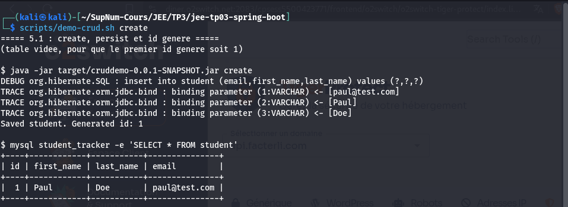
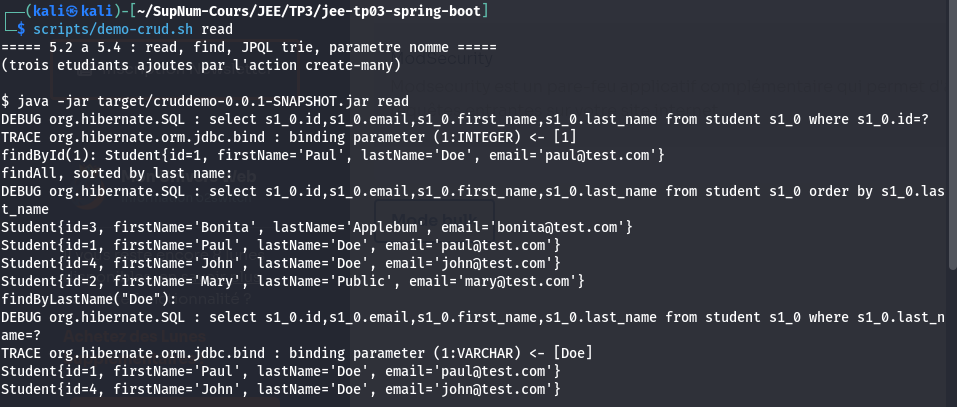
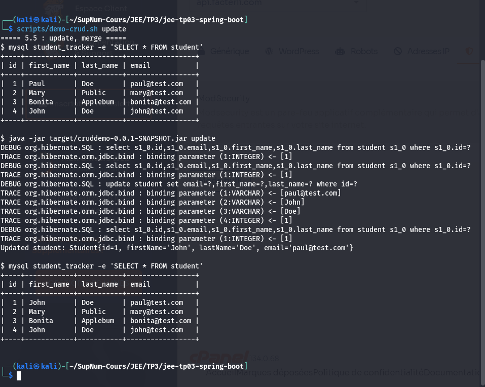
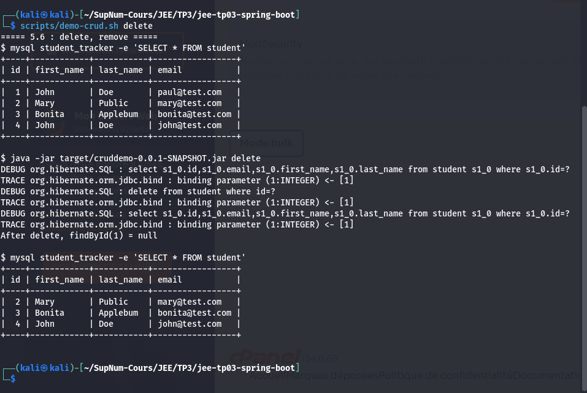

# cruddemo

[](https://github.com/LeminEly/jee-tp03-spring-boot/actions/workflows/ci.yml)

TP 03 du module JEE : Hibernate et JPA, CRUD avec l'`EntityManager`.

Une application console, sans serveur web. Un `CommandLineRunner` lit une action
en argument, l'execute sur la table `student` de MySQL par la couche DAO, puis
l'application s'arrete. Les logs SQL d'Hibernate montrent chaque requete et ses
valeurs liees.

## Prerequis

- JDK 25, fige dans `.sdkmanrc` : `sdk env`, puis `javac -version` doit afficher 25.
- Une base MySQL, au choix :
  - **le conteneur fourni** : `docker compose up -d --wait`. MySQL 8.4 sur
    `127.0.0.1:3307`, deja initialise par les scripts de `00-starter-sql-scripts/` ;
  - **une installation MySQL existante** sur 3306 : executer en root
    `00-starter-sql-scripts/01-create-user.sql` puis `02-student-tracker.sql`.

Maven est fourni par le wrapper `./mvnw`.

## Lancer

```sh
./mvnw package

# installation MySQL sur 3306, la configuration de l'enonce :
java -jar target/cruddemo-0.0.1-SNAPSHOT.jar create

# conteneur fourni, sur 3307 :
SPRING_DATASOURCE_URL=jdbc:mysql://localhost:3307/student_tracker \
  java -jar target/cruddemo-0.0.1-SNAPSHOT.jar create

# ou par le plugin Maven :
./mvnw spring-boot:run -Dspring-boot.run.arguments=read
```

| Action | Ce qu'elle fait | Exercice |
| --- | --- | --- |
| `create` | Enregistre Paul Doe et affiche l'id genere | 5.1 |
| `read` (defaut) | `findById(1)`, `findAll` trie, `findByLastName("Doe")` | 5.2 a 5.4 |
| `update` | Lit l'etudiant 1, change son prenom en John, enregistre | 5.5 |
| `delete` | Supprime l'etudiant 1. Sans effet si l'id n'existe pas | 5.6 |
| `create-many` | Enregistre trois autres etudiants | 5.3 |
| `update-emails` | Mise a jour en masse des `Doe` | 5.7, bonus |
| `delete-all` | Suppression en masse, affiche le nombre de lignes | 5.7 |
| `find-named` | Meme recherche que 5.4, par `@NamedQuery` | bonus 2 |
| `enroll-batch` | Lot tout ou rien par la couche service | bonus 3 |

## Organisation

```
com.tp3.cruddemo            CruddemoApplication, le pilote par argument
com.tp3.cruddemo.entity     Student
com.tp3.cruddemo.dao        StudentDAO, StudentDAOImpl (@Repository, EntityManager)
com.tp3.cruddemo.service    StudentService, StudentServiceImpl (bonus 3)
```

`@Transactional` est sur chaque ecriture du DAO, et sur aucune lecture.

## Tests

```sh
./mvnw test
```

Vingt et un tests, sur une base H2 en memoire : ils vident la table, et ne
doivent jamais toucher celle de MySQL. Ils couvrent chaque methode du DAO et
figent les comportements de JPA sur lesquels s'appuient les reponses.

La fidelite a MySQL est verifiee a part :

```sh
scripts/verifier-crud.sh     # vide la table student
```

Le script joue chaque action contre MySQL en `ddl-auto=validate`, et verifie
chaque resultat. L'integration continue le rejoue a chaque poussee.

## Qualite et integration continue

| Porte | Ou | Ce qu'elle refuse |
| --- | --- | --- |
| `pre-commit` | local et CI | Espaces en fin de ligne, YAML, TOML et XML invalides, fichiers de plus de 512 Ko, cles privees |
| `gitleaks` | local et CI | Secrets, et sur **tout** l'historique en CI |
| Message de commit | local | Tout message hors convention |
| `./mvnw test` | local et CI | Code qui ne compile pas, test rouge, mauvais JDK |
| `verifier-crud.sh` | CI | Entite qui diverge du script SQL, action CRUD fausse sur MySQL |

Chacune a ete soumise a un cas fautif et vue refuser.

```sh
pre-commit install && pre-commit install --hook-type commit-msg
```

## Captures d'ecran

Prises en lancant `scripts/demo-crud.sh` avec l'action indiquee, dans l'ordre.

### 5.1 : create, et l'extrait des logs SQL

`scripts/demo-crud.sh create`



L'`INSERT` et ses trois valeurs liees sont l'extrait de logs SQL que demande
l'enonce.

### 5.2 a 5.4 : read

`scripts/demo-crud.sh read`



### 5.5 : update, la table avant et apres

`scripts/demo-crud.sh update`



### 5.6 : delete

`scripts/demo-crud.sh delete`



## Reponses aux questions

Voir `REPONSES.md` : les huit questions, les tableaux `persist` / `merge` et
`ddl-auto` completes par des mesures sur MySQL, les trois extensions de la
section 9, et les ecarts assumes.
